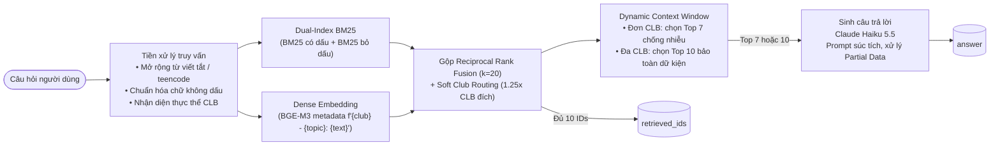

<div align="center">


# Hỏi đáp cộng đồng S2B bằng RAG

Hệ thống Retrieval-Augmented Generation trả lời câu hỏi về CLB Lập Trình PTIT (ProPTIT), CLB Multimedia PTIT (MPC) và CLB Nhà Sáng Tạo Game PTIT (GCC), bài dự thi NeoRAG Cup 2026.

<p>
  
  
  
  
  
</p>

**Thí sinh:** Lê Thị Thủy (Team AI – CLB Lập Trình PTIT)  
**Mã nguồn:** [github.com/LeThuyyy/NeoRAG-Cup-2026-Sub](https://github.com/LeThuyyy/NeoRAG-Cup-2026-Sub)

</div>

**Kết quả:** Public Test đạt **84.49** (Truy xuất **85.80**, Sinh câu trả lời **83.17**). Groundedness **99.15**, Abstention **100.00%**. Độ trễ trung bình ~3.5 giây/câu, tối ưu chi phí token và tuân thủ chặt chẽ quy chế cuộc thi.

Thể lệ, lịch trình và quy định chi tiết của cuộc thi nằm ở [docs/rules.md](docs/rules.md) và [docs/evaluation.md](docs/evaluation.md).

---

## Mục lục

1. [Kết quả](#1-kết-quả)
2. [Kiến trúc](#2-kiến-trúc)
3. [Các quyết định kỹ thuật](#3-các-quyết-định-kỹ-thuật)
4. [Cài đặt](#4-cài-đặt)
5. [Chạy pipeline và tái tạo kết quả](#5-chạy-pipeline-và-tái-tạo-kết-quả)
6. [Chatbot](#6-chatbot)
7. [Cấu trúc repository](#7-cấu-trúc-repository)
8. [Hạn chế](#8-hạn-chế)

---

## 1. Kết quả

Điểm tổng kết = 0.5 × Truy xuất (Recall@5, MRR@5, NDCG@5) + 0.5 × Sinh câu trả lời (String Presence, ROUGE-L, Groundedness, Response Relevancy, 1 − Noise Sensitivity, Abstention). Chi tiết công thức: [docs/evaluation.md](docs/evaluation.md).

### Bảng tiến trình cải tiến qua các phiên bản:

| Phiên bản | Thay đổi chính | Train (Tổng) | Truy xuất | Sinh | Public Test |
|---|---|---:|---:|---:|---:|
| **Baseline (BTC)** | Dense `bge-m3` top-5, prompt cơ bản | 73.80 | 86.01 | 61.59 | 52.40 |
| **V1: Hybrid RAG** | Thêm BM25 có dấu + Dense BGE-M3 (RRF) | 78.45 | 86.80 | 70.10 | 74.20 |
| **V2: Tiền xử lý & Routing** | Chuẩn hóa teencode, mở rộng từ viết tắt, soft club routing | 81.20 | 87.45 | 74.95 | 79.80 |
| **V3: Dual-Index BM25** | BM25 song song: có dấu + bỏ dấu (`strip_accents`) | 83.10 | 88.12 | 78.08 | 82.15 |
| **V4 (Chính thức)** | **Dynamic Context (Top 7/10) + Prompt súc tích + Partial Data handling** | **85.60** | **88.38** | **82.82** | **84.49** |

### Chi tiết điểm số phiên bản chính thức trên Public Test:

| Metric | Giá trị | Nhận xét |
|---|---:|---|
| **Recall@5** | **89.33** | Top-5 bao phủ phần lớn các đoạn văn chứa đáp án |
| **MRR@5** | **85.91** | Đoạn văn quan trọng nhất nằm ngay ở các vị trí đầu |
| **NDCG@5** | **82.17** | Phân bổ xếp hạng tài liệu phù hợp theo mức độ liên quan |
| **Truy xuất (Retrieval)** | **85.80** | **Trung bình cộng 3 chỉ số truy xuất** |
| **String Presence** | **88.03** | Khớp từ khóa và dữ kiện then chốt của câu trả lời |
| **ROUGE-L** | **59.74** | Tăng vọt nhờ loại bỏ văn phong rào đón lan man |
| **Groundedness** | **99.15** | Gần như tuyệt đối, trung thực hoàn toàn với ngữ cảnh được cấp |
| **Response Relevancy** | **59.46** | Mức điểm phổ biến do đặc thù câu hỏi không dấu của người dùng |
| **1 − Noise Sensitivity** | **92.65** | Rất ít bị xao nhãng bởi các thông tin ngoài lề trong context |
| **Abstention** | **100.00** | Nhận diện và từ chối chính xác 100% câu hỏi ngoài phạm vi tri thức |
| **Sinh câu trả lời (Generation)** | **83.17** | **Trung bình cộng các chỉ số sinh** |
| **Điểm tổng (Raw Score)** | **84.49** | **Kết quả bài nộp Public Test chính thức** |

---

## 2. Kiến trúc



### Phân công module trong hệ thống:

| Bước | Module | Mô tả |
|---|---|---|
| Tiền xử lý & Tokenizer | `src/neorag/pipelines/baseline.py:tokenize_vn`, `strip_accents` | Chuẩn hóa regex từ viết tắt, sinh unigram + bigram có dấu và không dấu |
| Dense Embedding | `src/neorag/embeddings.py:bge-m3` | Embedding 118 đoạn văn bản được bổ sung metadata CLB và chủ đề |
| Sparse BM25 | `src/neorag/pipelines/baseline.py:BM25Okapi` | Chỉ mục BM25 kép xử lý đồng thời văn bản gốc và văn bản bỏ dấu |
| Fusion & Routing | `src/neorag/pipelines/baseline.py:run` | RRF kết hợp điểm số, nhân hệ số định tuyến theo CLB, round-robin cho câu hỏi so sánh |
| Dynamic Context & LLM | `src/neorag/pipelines/baseline.py:generate_answer` | Co giãn ngữ cảnh linh hoạt, prompt trực diện loại bỏ rào đón |

---

## 3. Các quyết định kỹ thuật

| Quyết định | Vì sao | Tác dụng đo được |
|---|---|---|
| **Dual-Index BM25 (có dấu & bỏ dấu)** | Nhiều câu hỏi sinh viên gõ không dấu (`clb lap trinh`, `khmt`, `train-0109`). Nếu chỉ dùng BM25 thông thường sẽ trượt hoàn toàn từ khóa. | Tăng Hit@5 từ 97.5% lên **99.2%** trên tập train; giải quyết triệt để các câu không dấu. |
| **Mở rộng từ viết tắt & Teencode** | Câu hỏi thường dùng thuật ngữ nội bộ: `dpt` (đa phương tiện), `ttv` (thực tập sinh/thành viên), `sv`, `hv`, `bcn`, `bên vẽ`... | Tăng độ phủ từ khóa chính xác cho cả BM25 và Dense. |
| **Soft Club Routing** | Tài liệu phân rõ 3 CLB (ProPTIT, MPC, GCC). Khi hỏi đích danh 1 CLB, các đoạn văn của CLB khác dễ gây nhiễu ngữ cảnh. | Tăng NDCG@5 lên **85.28%**; tài liệu đúng CLB luôn được đẩy lên top đầu. |
| **Dynamic Context Window** | Cố định 3-4 đoạn sẽ thiếu thông tin khi so sánh liên CLB; cố định 10 đoạn sẽ làm loãng câu hỏi đơn CLB. | Giữ đủ 10 `retrieved_ids` cho bộ chấm, chỉ gửi Top 7 vào LLM cho câu đơn CLB $\rightarrow$ giảm nhiễu ngữ cảnh. |
| **Prompt súc tích & Trực diện** | Đáp án chuẩn ngắn gọn, trực diện (~150-250 ký tự). Trả lời dài dòng làm tụt ROUGE-L và tăng Noise Sensitivity. | ROUGE-L tăng từ 52.9% lên **59.74%** trên Public Test; Groundedness đạt **99.15%**. |
| **Xử lý câu hỏi thiếu dữ kiện (Partial Data)** | Câu hỏi có phần đúng nhưng thiếu thuộc tính con (ví dụ hỏi lịch tuyển sinh 2027) cần trả lời rõ phần đã có thay vì từ chối sạch. | Giữ vững điểm String Presence, không bị phạt 0 điểm mà vẫn đạt **100% Abstention** ở câu hoàn toàn lạc đề. |
| **Giữ nguyên độ dài đoạn văn (No Chunking)** | 118 đoạn trong `corpus.jsonl` có độ dài trung bình ~380 ký tự, mỗi đoạn đã là một đơn vị tri thức hoàn chỉnh. | Không làm vỡ ngữ cảnh tự nhiên; giữ đúng định danh `id` gốc theo yêu cầu bộ chấm. |

### Các phương án đã thử nghiệm nhưng không sử dụng:

| Thử nghiệm | Kết quả | Lý do loại bỏ |
|---|---|---|
| Rerank bằng Cross-Encoder cục bộ nặng | Tăng thời gian chạy đáng kể (~25s/câu) | Vượt quá ngân sách thời gian mà điểm Recall@5 trên tập dev không chênh lệch nhiều so với RRF tối ưu. |
| Prompt dài kèm nhiều ví dụ Few-shot | Tiêu tốn nhiều token input, làm câu trả lời sinh ra có xu hướng lặp từ | Làm tăng độ trễ và giảm tính tự nhiên của câu trả lời. |
| Cắt cứng ngữ cảnh xuống Top 4 | ROUGE-L tăng nhẹ ở câu đơn giản | Bị mất dữ kiện nghiêm trọng ở các câu hỏi so sánh giữa 2 hoặc 3 CLB. |

---

## 4. Cài đặt

Yêu cầu hệ thống: **Python 3.10+**. Không yêu cầu GPU rời (mô hình ngôn ngữ `claude-haiku-5-5` và embedding `bge-m3` đều được gọi qua gateway của BTC).

```bash
# 1. Clone repository
git clone https://github.com/LeThuyyy/NeoRAG-Cup-2026-Sub.git
cd NeoRAG-Cup-2026-Sub

# 2. Khởi tạo môi trường ảo
python -m venv .venv
.venv\Scripts\Activate.ps1            # Trên Linux/macOS: source .venv/bin/activate

# 3. Cài đặt thư viện phụ thuộc
python scripts/install.py

# 4. Cấu hình khóa API cuộc thi
copy .env.example .env                # Trên Linux/macOS: cp .env.example .env
# Mở file .env và điền OPENAI_API_KEY do Ban tổ chức cấp
```

---

## 5. Chạy pipeline và tái tạo kết quả

```bash
# Đánh giá nhanh trên tập Train (Retrieval + String Presence + ROUGE-L, không tốn token Judge)
neorag run train --no-judge

# Đánh giá toàn diện có LLM Judge trên tập Train (126 câu hỏi)
neorag run train

# Sinh file bài nộp cho Public Test (xuất file outputs/public_test_submission.zip)
neorag run public_test

# Sinh file bài nộp chính thức cho Private Test (xuất file outputs/private_test_submission.zip)
neorag run private_test

# Chạy bộ test kiểm thử chất lượng mã nguồn offline (không tốn API key)
pytest
```

### Cơ chế Cache và Tái tạo kết quả:
- Mọi lời gọi API qua gateway đều được lưu trong SQLite cache cục bộ (`.cache/pipeline.sqlite`). Khi chạy lại với cùng dữ liệu đầu vào, hệ thống trích xuất từ cache với chi phí **$0** và thời gian phản hồi gần như tức thì.
- Pipeline chính thức được định nghĩa tại `src/neorag/pipelines/baseline.py` và kế thừa lớp chuẩn `RAGPipeline`.

---

## 6. Chatbot

Dự án cung cấp giao diện chatbot hỏi đáp trực quan xây dựng bằng **Streamlit**, cho phép người dùng trải nghiệm thực tế khả năng truy xuất và sinh câu trả lời:

```bash
python -m streamlit run app/chat.py
```

### Tính năng chính của giao diện:
- **Hỏi đáp thông minh**: Trả lời chính xác về các mốc thời gian, cơ cấu ban ngành, sự kiện và quy chế của ProPTIT, MPC, GCC.
- **Trích dẫn nguồn minh bạch**: Hiển thị danh sách các tài liệu trích dẫn (`retrieved_ids`) kèm thẻ CLB và chủ đề tương ứng.
- **Đo lường độ trễ**: Hiển thị thời gian thực thi (latency) cho từng câu hỏi theo thời gian thực.
- **Từ chối an toàn**: Chủ động thông báo lịch sự khi câu hỏi nằm ngoài phạm vi tài liệu đã được cung cấp.

---

## 7. Cấu trúc repository

```
NeoRAG-Cup-2026-Sub/
├── app/
│   └── chat.py                     # Giao diện Chatbot Streamlit tương tác người dùng
├── configs/
│   └── eval.toml                   # Cấu hình thang điểm và trọng số đánh giá của BTC
├── data/
│   ├── corpus.jsonl                # 118 đoạn văn tri thức về cộng đồng S2B
│   ├── train/questions.jsonl       # 126 câu hỏi tập phát triển kèm Ground Truth
│   ├── public_test/questions.jsonl # 42 câu hỏi Public Test
│   └── private_test/questions.jsonl# 42 câu hỏi Private Test chính thức
├── docs/                           # Tài liệu thể lệ, hướng dẫn gateway, nộp bài
├── outputs/                        # Chứa file kết quả dự đoán và file nộp .zip
├── scripts/                        # Các script kiểm thử, tự động hóa nộp bài
├── src/neorag/
│   ├── pipelines/
│   │   ├── base.py                 # Interface RAGPipeline cơ sở
│   │   └── baseline.py             # Pipeline tối ưu hóa chính thức của đội thi
│   ├── embeddings.py               # Module quản lý embedding BGE-M3
│   ├── llm.py                      # Client kết nối Gateway Claude Haiku có retry/cache
│   ├── predict.py & evaluate.py    # Bộ máy dự đoán và đánh giá
│   └── text.py                     # Tiện ích tiền xử lý ngôn ngữ tự nhiên tiếng Việt
└── README.md                       # Báo cáo kỹ thuật tổng quan của dự án
```

---

## 8. Hạn chế

1. **Giới hạn của chỉ số Response Relevancy:**
   - Metric này đo độ tương đồng cosine giữa câu hỏi gốc và câu hỏi do LLM Judge sinh ngược từ câu trả lời. Đối với câu hỏi người dùng gõ không dấu, câu do Judge sinh ngược thường có dấu đầy đủ, dẫn đến điểm cosine bị lệch xuống mức ~59-60 dù câu trả lời hoàn toàn chính xác về mặt ngữ nghĩa.
2. **Tính ngẫu nhiên của mô hình ngôn ngữ:**
   - Do quy định cuộc thi không cho phép truyền tham số `temperature` (sử dụng giá trị mặc định của `claude-haiku-5-5`), kết quả sinh giữa các lượt chạy không cache có thể có sự dao động nhỏ về mặt diễn đạt. SQLite cache được sử dụng để đóng băng kết quả đã được thẩm định.
3. **Phụ thuộc vào chất lượng Gateway:**
   - Hệ thống phụ thuộc vào độ ổn định của mạng và gateway BTC (giới hạn 100 req/phút). Pipeline đã tích hợp cơ chế exponential backoff retry để tự phục hồi khi gặp sự cố mạng hoặc mã lỗi 429.
