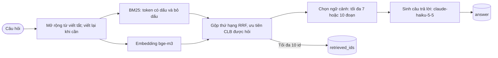

<div align="center">


# Hỏi đáp cộng đồng S2B bằng RAG

Hệ thống Retrieval-Augmented Generation trả lời câu hỏi về CLB Lập Trình PTIT (ProPTIT), CLB Multimedia PTIT (MPC) và CLB Nhà Sáng Tạo Game PTIT (GCC), bài dự thi NeoRAG Cup 2026.

<p>
  
  
  
  
</p>

**Thí sinh:** Lê Thị Thủy (Team AI – CLB Lập Trình PTIT)  
**Mã nguồn:** [github.com/LeThuyyy/NeoRAG-Cup-2026-Sub](https://github.com/LeThuyyy/NeoRAG-Cup-2026-Sub)

</div>

**Kết quả:** Public Test **85,56/100** (Truy xuất **87,01**, Sinh **84,11**); Private Test **80,57/100** (Truy xuất **82,08**, Sinh **79,07**).

Thể lệ, lịch trình và quy định chi tiết của cuộc thi nằm ở [docs/rules.md](docs/rules.md) và [docs/evaluation.md](docs/evaluation.md).

---

## Mục lục

1. [Kết quả](#1-kết-quả)
2. [Kiến trúc](#2-kiến-trúc)
3. [Các quyết định kỹ thuật](#3-các-quyết-định-kỹ-thuật)
4. [Cài đặt](#4-cài-đặt)
5. [Chạy pipeline và tái tạo kết quả](#5-chạy-pipeline-và-tái-tạo-kết-quả)
6. [Chatbot](#6-chatbot)
7. [Cấu trúc repository](#7-cấu-trúc-repository)
8. [Hạn chế](#8-hạn-chế)

---

## 1. Kết quả

Điểm tổng kết = 0.5 × Truy xuất (Recall@5, MRR@5, NDCG@5) + 0.5 × Sinh câu trả lời (String Presence, ROUGE-L, Groundedness, Response Relevancy, 1 − Noise Sensitivity, Abstention). Chi tiết công thức: [docs/evaluation.md](docs/evaluation.md).

### Kết quả trên hệ thống chấm

| Chỉ số | Public Test cao nhất | Private Test |
|---|---:|---:|
| Recall@5 | 87,34 | 83,73 |
| MRR@5 | 90,48 | 84,21 |
| NDCG@5 | 83,21 | 78,30 |
| **Truy xuất** | **87,01** | **82,08** |
| String Presence | 90,60 | 81,41 |
| ROUGE-L | 61,78 | 54,94 |
| Groundedness | 99,57 | 96,15 |
| Response Relevancy | 58,27 | 56,83 |
| 1 − Noise Sensitivity | 94,43 | 85,09 |
| Abstention | 100,00 | 100,00 |
| **Sinh câu trả lời** | **84,11** | **79,07** |
| **Raw score** | **85,56** | **80,57** |

---

## 2. Kiến trúc



### Phân công module trong hệ thống:

| Bước | Module | Mô tả |
|---|---|---|
| Tiền xử lý và viết lại truy vấn | `src/neorag/pipelines/baseline.py` | Mở rộng từ viết tắt; gọi Haiku để viết lại câu hỏi khi phát hiện chữ không dấu, viết tắt hoặc câu hỏi nhiều CLB |
| Dense embedding | `src/neorag/pipelines/baseline.py:GatewayEmbedder` | Gọi `bge-m3` qua gateway; nội dung lập chỉ mục kèm tên CLB và chủ đề |
| BM25 | `src/neorag/pipelines/baseline.py:BM25Index` | Dùng unigram và bigram ở cả dạng có dấu lẫn bỏ dấu trong cùng một chỉ mục |
| Gộp và xếp hạng | `src/neorag/pipelines/baseline.py:rank_single_query` | Gộp thứ hạng dense/BM25 bằng RRF; ưu tiên CLB được hỏi; xen kẽ kết quả khi có nhiều truy vấn con |
| Ngữ cảnh và sinh câu trả lời | `src/neorag/pipelines/baseline.py:run` | Trả tối đa 10 ID; đưa tối đa 7 hoặc 10 đoạn vào prompt tùy loại câu hỏi |

---

## 3. Các quyết định kỹ thuật

| Quyết định | Lý do và cách triển khai |
|---|---|
| **BM25 có dấu và bỏ dấu** | `BM25Index` lập token unigram/bigram từ văn bản gốc và văn bản bỏ dấu trong cùng một chỉ mục, giúp truy vấn không dấu có thêm cơ hội khớp từ khóa. |
| **Mở rộng từ viết tắt** | `expand_abbreviations` thay một số cách gọi CLB và từ viết tắt thường gặp trước khi tìm kiếm. Với câu hỏi cần chuẩn hóa, pipeline có thể gọi Haiku viết lại truy vấn. |
| **Ưu tiên CLB được hỏi** | Sau khi gộp thứ hạng BM25 và dense bằng RRF, `rank_single_query` nhân hệ số cho tài liệu thuộc CLB được nhận diện; truy vấn nhiều CLB được xen kẽ kết quả. |
| **Ngữ cảnh thay đổi theo câu hỏi** | Pipeline trả tối đa 10 ID; mặc định đưa tối đa 7 đoạn vào prompt cho câu hỏi một CLB, tối đa 10 đoạn cho câu hỏi nhiều CLB. |
| **Trả lời theo tài liệu** | Prompt yêu cầu câu trả lời ngắn, không tự suy diễn và nói rõ khi thiếu dữ kiện hoặc câu hỏi ngoài tài liệu. |
| **Giữ ID đoạn gốc** | Pipeline lập chỉ mục theo các đoạn trong corpus và trả về `id` của đoạn gốc để phù hợp định dạng bài nộp. |

---

## 4. Cài đặt

Yêu cầu hệ thống: **Python 3.10+**. Không yêu cầu GPU rời (mô hình ngôn ngữ `claude-haiku-5-5` và embedding `bge-m3` đều được gọi qua gateway của BTC).

```bash
# 1. Clone repository
git clone https://github.com/LeThuyyy/NeoRAG-Cup-2026-Sub.git
cd NeoRAG-Cup-2026-Sub

# 2. Khởi tạo môi trường ảo
python -m venv .venv
.venv\Scripts\Activate.ps1            # Trên Linux/macOS: source .venv/bin/activate

# 3. Cài đặt thư viện phụ thuộc
python scripts/install.py

# 4. Cấu hình khóa API cuộc thi
copy .env.example .env                # Trên Linux/macOS: cp .env.example .env
# Mở file .env và điền OPENAI_API_KEY do Ban tổ chức cấp
```

---

## 5. Chạy pipeline và tái tạo kết quả

```bash
# Đánh giá nhanh trên tập Train (Retrieval + String Presence + ROUGE-L, không tốn token Judge)
neorag run train --no-judge

# Đánh giá toàn diện có LLM Judge trên tập Train (126 câu hỏi)
neorag run train

# Sinh file bài nộp cho Public Test (xuất file outputs/public_test_submission.zip)
neorag run public_test

# Sinh file bài nộp cho Private Test (xuất file outputs/private_test_submission.zip)
neorag run private_test

# Chạy bộ test kiểm thử chất lượng mã nguồn offline (không tốn API key)
pytest
```

### Cơ chế Cache và Tái tạo kết quả:
- Client lưu kết quả lời gọi API trong SQLite cache cục bộ (`.cache/pipeline.sqlite`). Lời gọi trùng đầu vào có thể dùng lại kết quả đã lưu thay vì gọi gateway lần nữa.
- Pipeline mặc định được định nghĩa tại `src/neorag/pipelines/baseline.py` và kế thừa lớp `RAGPipeline`.

---

## 6. Chatbot

Dự án cung cấp giao diện chatbot hỏi đáp trực quan xây dựng bằng **Streamlit**, cho phép người dùng trải nghiệm thực tế khả năng truy xuất và sinh câu trả lời:

```bash
python -m streamlit run app/chat.py
```

### Tính năng chính của giao diện:
- Nhận câu hỏi về ProPTIT, MPC, GCC và hiển thị câu trả lời từ pipeline.
- Trong mục «Nguồn tham khảo», hiển thị các đoạn đã truy xuất cùng tên CLB, chủ đề, văn bản và thời gian phản hồi.
- Với câu hỏi ngoài phạm vi tài liệu, pipeline được hướng dẫn trả lời rằng chưa tìm thấy thông tin.

---

## 7. Cấu trúc repository

```
NeoRAG-Cup-2026-Sub/
├── app/
│   └── chat.py                     # Giao diện Chatbot Streamlit tương tác người dùng
├── configs/
│   └── eval.toml                   # Cấu hình thang điểm và trọng số đánh giá của BTC
├── data/
│   ├── corpus.jsonl                # 118 đoạn văn tri thức về cộng đồng S2B
│   ├── train/questions.jsonl       # 126 câu hỏi tập phát triển kèm Ground Truth
│   ├── public_test/questions.jsonl # 42 câu hỏi Public Test
│   └── private_test/questions.jsonl# 42 câu hỏi Private Test chính thức
├── docs/                           # Tài liệu thể lệ, hướng dẫn gateway, nộp bài
├── outputs/                        # Chứa file kết quả dự đoán và file nộp .zip
├── scripts/                        # Các script kiểm thử, tự động hóa nộp bài
├── src/neorag/
│   ├── pipelines/
│   │   ├── base.py                 # Interface RAGPipeline cơ sở
│   │   └── baseline.py             # Pipeline được chọn làm mặc định
│   ├── embeddings.py               # Module quản lý embedding BGE-M3
│   ├── llm.py                      # Client kết nối Gateway Claude Haiku có retry/cache
│   ├── predict.py & evaluate.py    # Bộ máy dự đoán và đánh giá
│   └── text.py                     # Tiện ích tiền xử lý ngôn ngữ tự nhiên tiếng Việt
└── README.md                       # Báo cáo kỹ thuật tổng quan của dự án
```

---

## 8. Hạn chế

- **Phụ thuộc gateway:** Truy vấn mới cần kết nối gateway để lấy embedding và sinh câu trả lời; khi mạng chậm hoặc gặp giới hạn tốc độ, thời gian phản hồi có thể tăng.
- **Kết quả sinh có thể thay đổi:** Mô hình không hỗ trợ đặt `temperature`; cache SQLite giúp dùng lại câu trả lời cho lời gọi có cùng đầu vào.
